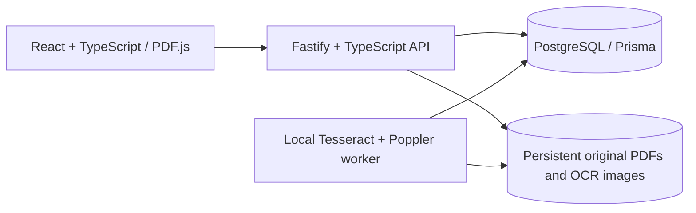
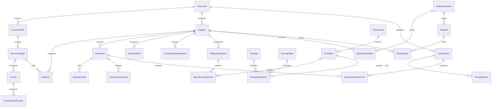

# Architecture and research identity

The Docker image contains the frontend, API and OCR executable dependencies. Compose starts a separate worker process sharing only this application's database and document volume. A database queue provides atomic job claiming, retained failures and retries as new jobs. Raw OCR recognition and manual transcription revisions are separate. Crops use normalised coordinates relative to the rotated page; original PDFs are untouched.

The migration runner takes an advisory lock, checks previous SQL checksums and applies each new migration transactionally. UUIDs identify research records; source-scoped published numbers are text attributes. Document/page/evidence foreign keys retain provenance. Prisma is the application ORM; migration history is managed by this repository's small SQL runner rather than Prisma Migrate.

A **Diagram** describes a published daily instruction. A **DiagramOperation** is its dated or explicitly named scenario-day instance. A **PhysicalSet** identifies researched stock continuity, when known. A **Formation** is a composition version; members can be anonymous quantities, known types or individually identified carriages. No published composition creates vehicle identities automatically. Stock assignments with overlapping known times are flagged across versions of the same physical set.

A scenario explicitly selects its diagrams, dates and assumptions. Connections carry day offsets, constraint results, separate confidence and review decision, optional continuation evidence and an optional documented transfer. The analyser never confirms from a station match. Rotation traversal uses only approved links and rechecks current constraints. Recurrence requires a closed path, compatible composition/times/source context, weekday invariance under the proposed period, and operating dates throughout the selected scenario. Unknown constraints and branches remain issues.

Rotation steps have relational diagram references and a display snapshot. Rebuild a rotation after changing its workings. Exports retain snapshot dates and warn about changed diagrams or unconfirmed rotations. Export snapshots use canonical serialization so PostgreSQL JSON key ordering cannot change a preview's bytes or checksum.

Verification records, research notes and audit events retain important decisions. Import/export batches record preview and commit boundaries. All historical source interpretation remains the researcher's responsibility.
