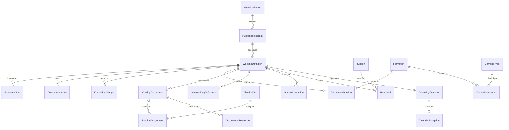

# Planner architecture

The application is a fresh manual-entry planner. React/TypeScript calls a Fastify/TypeScript API. PostgreSQL stores all research records through Prisma's JavaScript query engine and PostgreSQL driver adapter. Docker Compose runs only the app and database. There is no OCR worker, PDF processor, AI extraction service or Railway Operations Manager integration.

## Identity model

A published number is never a physical identity. Published diagram UUIDs are scoped by a historical period; identical number strings are allowed without automatic merging. A working definition can operate Monday–Friday and have a distinct Saturday variant with the same published number. A dated occurrence has a unique `(workingId, date)` key. Repeated timetable builds reuse that occurrence; the next Monday gets another UUID.

Physical sets have UUID primary keys and database-generated permanent serials displayed as `CS-0001`, etc. The API cannot change the serial. Serial gaps are allowed; numbers are not recycled through application operations. A manual assignment links a physical set to an occurrence, not to an unqualified diagram number.

For exclusive occurrences, a unique database key provides atomic allocation protection. Removing an assignment marks it inactive and records its prior values rather than deleting the research record. Nonexclusive workings can intentionally receive several sets; more sophisticated physical-stock compatibility and overlap checks belong to Phase 2.

## Calendars and dates

Weekdays are Monday=0 through Sunday=6. Optional historical-period and working bounds are inclusive. Dated exceptions override weekday rules within those bounds. Dates are PostgreSQL `date`, carried through the API as calendar dates; modern time-zone conversion is not applied to historical clock values.

Starting/finishing times are optional minutes from midnight with separate explicit day offsets. The data model preserves missing times, same-day references and overnight workings. The checker uses explicit day offsets; it does not infer a midnight crossing from clock values.

## Entered continuation references

Each working can have a different next-working reference for each source weekday. A reference retains the entered published number, optional selected target working UUID, one date rule (elapsed days, next weekday or explicit date), instruction kind and notes. An ambiguous typed number remains unresolved; the app never picks the first candidate.

When a timetable is materialised, resolved references identify the target dated occurrence through a separate `OccurrenceReference`. A target not operating on its entered calendar does not receive an invented occurrence. The entered instruction is retained, with a descriptive note in the timetable. Continuity analysis separately checks live locations, dates, times and formations. Calendar materialisation alone does not approve a connection.

Stabling has no invented train movement or target stock identity. Duration may be unknown. A date rule selecting the same weekday means the following week; an explicit day offset of zero represents the same day.

## Formations and source evidence

Formation members may have an unknown type, quantity or position. An identified vehicle number requires quantity one. Exact totals require a known formation with known member quantities; incomplete/unknown records show only the known minimum. Day variations override the base formation; an explicit unknown variation remains unknown. Attach/detach records preserve entered facts without automatically proving composition compatibility.

Sources are manually typed citations; no files are processed. Working edits retain citations. Changes to route calls, instructions, exceptions and formation members keep their previous values in an audit snapshot. Material edits require a reason and working/formation revisions protect against stale saves.

## Continuity and rotation records

`DatasetState` versions input changes. `AnalysisRun` scopes a dated historical-period window; machine `ConnectionProposal` records are separate from `ConnectionReview` and `ApprovedConnection`. Unique analysis/pair keys make repeated checking idempotent. Human decisions survive machine recalculation.

`ConnectingMovement` stores only manually entered transfers with dates, stations, times and citations. `PlanningIssue` has a stable finding key, immutable original finding, latest details, active-detection flag and independent research state. `IssueReview` retains the investigation trail; dismissal does not imply resolution.

`ChainProposal` stores a dated chain snapshot with explained links and stabling gaps. `SavedRotation` associates an explicitly approved snapshot with a permanent `PhysicalSet`. The corresponding dated `RotationAssignment` records populate the master board. Saved snapshots are never replaced by recalculation. Unlocking permits manual link/assignment review, with an audit reason. A revised approval creates another retained snapshot rather than editing the previous one.

Generation follows explicit or approved links; it never chooses an unapproved station-match candidate. Multiple incoming chains stop at their conflict. Actual occurrences remain distinct across weeks. Repeat detection compares working identity, effective formation, changes and instructions over at least two observed cycles. The result is evidence within the selected horizon, not an assertion of indefinite historical recurrence.

Base formations describe departure stock: outgoing En route/Finish changes are applied, and the next working's Start changes are subtracted for handover comparison. Missing quantities, times and locations remain uncertain. Definite contradictions block approval; warnings/unknowns require explicit acknowledgement.

Foreign keys for analysis/research scalar identifiers are enforced by additive SQL migrations, including links to exact dated occurrences. JSON snapshots retain source facts even when live names or definitions are edited. The custom migration runner validates immutable checksums.

## Deferred reports

Dedicated PDF/Excel/CSV downloads and print-oriented research summaries are outside this build.
